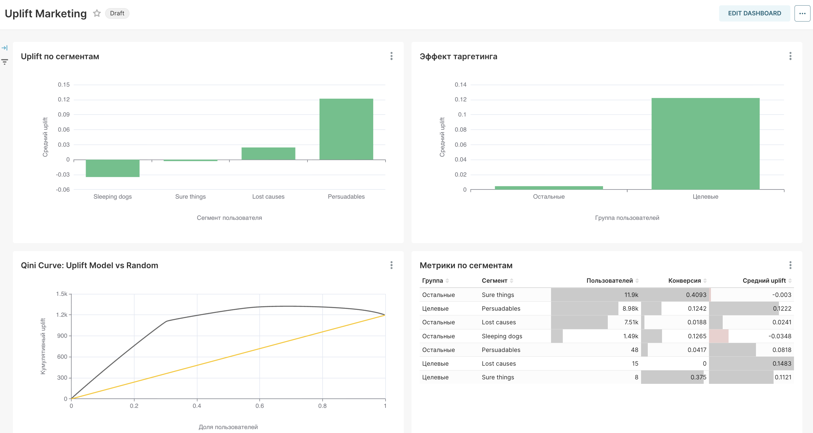

# Uplift Modeling for Marketing Campaigns

Uplift-модель для оптимизации маркетинговых рассылок. Предсказывает **не «купит ли пользователь»**, а **«повлияет ли на него реклама»**.

## 🎬 Демо



## Бизнес-задача

Маркетинг тратит бюджет на всех пользователей. Но есть важные сегменты пользователей:
| Сегмент | Поведение | Реклама нужна? |
|---|---|---|
| **Sure things** | Купят и без рекламы | ❌ Нет |
| **Persuadables** | Купят только с рекламой | ✅ **Да** |
| **Lost causes** | Не купят даже с рекламой | ❌ Нет |
| **Sleeping dogs** | Реклама им вредит | ❌ Нет |

**Цель:** найти **persuadables** и не тратить на остальных.

## Данные

- **100 000 пользователей**.
- Случайное разделение control/test (**50/50**).
- **4 сегмента:**
  - Sure things — 40%
  - Persuadables — 30%
  - Lost causes — 25%
  - Sleeping dogs — 5%

## Модель

| Параметр | Значение |
|---|---|
| **Алгоритм** | TwoModels (RandomForest) |
| **Библиотека** | `scikit-uplift` |
| **Control-модель** | RandomForestClassifier (n=100, depth=5) |
| **Test-модель** | RandomForestClassifier (n=100, depth=5) |
| **Train size** | 70 000 |
| **Test size** | 30 000 |

### Метрики

| Метрика | Значение | Комментарий |
|---|---|---|
| **AUUC** | 0.0683 | Area Under Uplift Curve |
| **Qini AUC** | 0.0092 | Нормированный |
| **Uplift@10%** | **+15.7 п.п.** | Топ-10% пользователей |
| **Uplift@20%** | +15.1 п.п. | Топ-20% |
| **Uplift@30%** | +15.4 п.п. | Топ-30% |
| **Uplift@50%** | +9.1 п.п. | Топ-50% |
| **Baseline** | +3.8 п.п. | Случайный таргетинг |
| **Improvement @10%** | **4.17x** | Во сколько раз лучше |

## 📊 Результаты (ground truth)

**Эффект рекламы по истинным сегментам:**

| Сегмент | Control | Test | Uplift |
|---|---|---|---|
| **Persuadables** | 5.1% | 19.9% | **+14.8%** ⭐ |
| Lost causes | 1.9% | 2.0% | +0.1% |
| Sure things | 40.9% | 40.4% | -0.5% |
| **Sleeping dogs** | 15.4% | 10.5% | **-4.9%** ⚠️ |

Модель правильно классифицировала **99.76%** пользователей.

## 🎯 Эффект модели (предсказания)

**Модель разделила пользователей на 2 группы:**

| Группа | Пользователей | Uplift |
|---|---|---|
| **Целевые (топ-30%)** | **9 001** | **+12.2%** ⭐ |
| Остальные | 20 999 | +0.5% |

**Модель сократила аудиторию в 3.3 раза, сохранив 83% uplift.**

### Сравнение с массовой рассылкой

| Стратегия | Бюджет | Uplift | Эффект |
|---|---|---|---|
| **Массовая рассылка** | 100% | +3.8% | Базовая |
| **Модель (топ-30%)** | **30%** | **+12.2%** | **в 3.2 раза лучше** |

**Экономия бюджета:** 70%.
**Рост эффекта:** в 3.2 раза.

## Дашборд (Superset)

- **Qini Curve** — качество ранжирования модели.
- **Uplift по сегментам** — 4 группы пользователей.
- **Эффект таргетинга** — целевые vs остальные.
- **Метрики по сегментам** — детальная таблица.

## Стек

- **Python:** pandas, scikit-learn, scikit-uplift
- **Хранилище:** ClickHouse
- **Оркестрация:** Airflow
- **BI:** Superset
- **Инфраструктура:** Docker Compose

## Ключевые концепции

- **Causal inference:** эффект воздействия, а не корреляция.
- **Uplift:** разница между test и control.
- **Qini Curve:** кривая кумулятивного uplift.
- **Uplift@k:** uplift в топ-k% пользователей.
- **4 сегмента:** persuadables, sure things, lost causes, sleeping dogs.

## 🚀 Как запустить

### 1. Инфраструктура

```bash
docker compose up -d
```

#### Сервисы:

| Сервис | Сервис | Логин |
|---|---|---|
| Airflow | http://localhost:8083 | admin/admin |
| Superset | http://localhost:8089 | admin/admin | 
| ClickHouse | http://localhost:8126 | admin/admin123 | 

### 2.Данные

```bash
docker exec -it uplift_marketing-airflow-scheduler-1 bash -c "
cd /opt/airflow
python scripts/generate_data.py
python scripts/load_to_clickhouse.py
"
```

### 3. Модель

```bash
docker exec -it uplift_marketing-airflow-scheduler-1 bash -c "
cd /opt/airflow
python scripts/train_uplift.py
python scripts/load_predictions.py
"
```

### 4. Дашборд

Superset → http://localhost:8089 → Uplift Marketing.
